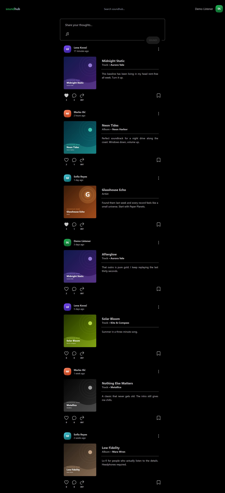
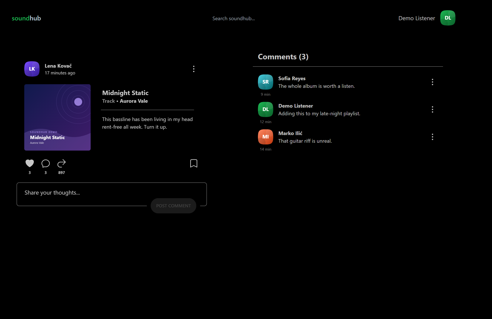
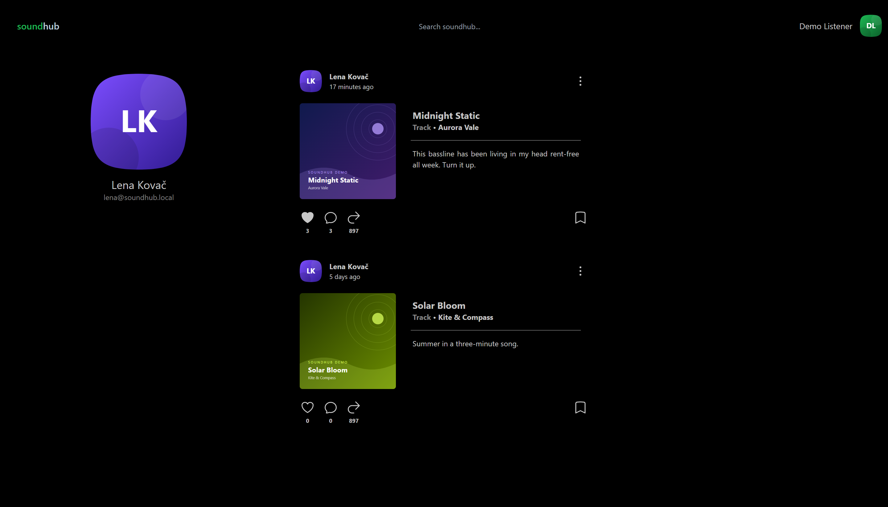
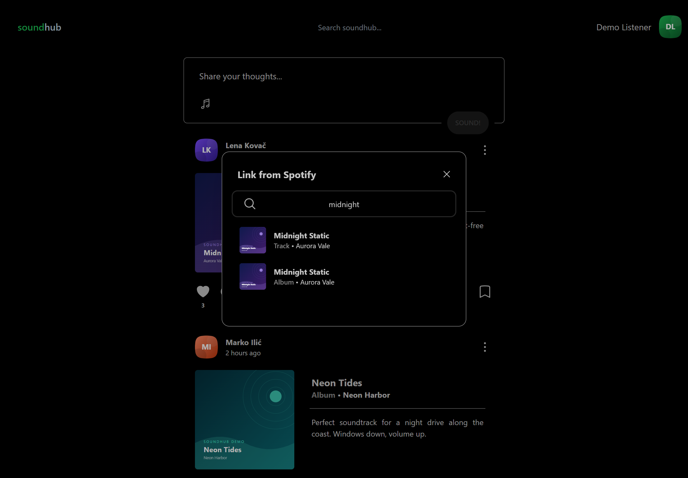

# soundhub

**Podijeli šta slušaš.** Mala društvena mreža za muziku: poveži pjesmu, album ili izvođača sa
Spotify-ja, napiši šta ti se sviđa i razgovaraj o tome sa drugima.

Aplikacija je napravljena u Next.js-u, sa tRPC backendom, Prisma bazom i Spotify OAuth
prijavom.



---

## Sadržaj

- [Funkcionalnosti](#funkcionalnosti)
- [Ekrani](#ekrani)
- [Tech stack](#tech-stack)
- [Arhitektura](#arhitektura)
- [Pokretanje](#pokretanje)
- [Struktura projekta](#struktura-projekta)

---

## Funkcionalnosti

- Prijava preko Spotify naloga.
- Objavljivanje "sound"-a: kratak komentar uz pjesmu, album ili izvođača.
- Pretraga Spotify kataloga sa odgodom unosa i beskonačnim skrolovanjem.
- Lajkovanje i komentarisanje objava.
- Profilna stranica korisnika sa svim njegovim objavama.
- Brisanje vlastitih objava i komentara, uz obavještenja.
- Responzivan tamni interfejs u Spotify zelenoj paleti (Tailwind + daisyUI).

## Ekrani

### Početna

Feed sa preporučenim objavama, forma za novi sound i pretraga u navigaciji.


### Detalji sound-a

Objava, brojači lajkova i komentara, te lista komentara sa formom za novi komentar.



### Profil korisnika

Profilna slika, podaci o korisniku i sve njegove objave.



### Povezivanje sa Spotify-ja

Dijalog za pretragu i izbor pjesme, albuma ili izvođača.



## Tech stack

| Sloj | Tehnologija |
| --- | --- |
| Framework | Next.js 13 (App Router, React Server Components) |
| Jezik | TypeScript |
| API | tRPC v10 + TanStack Query v4 |
| Baza | Prisma 5 / CockroachDB |
| Autentifikacija | NextAuth 4 (Spotify provider) |
| Spotify | `@spotify/web-api-ts-sdk` |
| Stilovi | Tailwind CSS 3 + daisyUI |
| Validacija | Zod |
| Serijalizacija | SuperJSON |

## Arhitektura

```
┌──────────────────────────────────────────────────────────────────┐
│  Browser (React 18, tRPC React Query, NextAuth SessionProvider)  │
└────────────────────────────────┬─────────────────────────────────┘
                                 │  /api/trpc
┌────────────────────────────────▼─────────────────────────────────┐
│  Next.js App Router                                              │
│  ├─ src/app/**/page.tsx      – server komponente                 │
│  └─ src/data/trpc/**         – tRPC ruteri                       │
└────────────────────────────────┬─────────────────────────────────┘
                                 │
┌────────────────────────────────▼─────────────────────────────────┐
│  Data sloj (src/data, src/mappers)                               │
│  ├─ prisma.ts      – pristup bazi                                │
│  ├─ spotify.ts     – Spotify klijent                             │
│  └─ auth/*         – sesija i NextAuth postavke                  │
└───────────────┬───────────────────────────────┬──────────────────┘
                │                               │
      ┌─────────▼─────────┐           ┌─────────▼─────────┐
      │  Prisma           │           │  Spotify Web API  │
      │  CockroachDB      │           │  + OAuth          │
      └───────────────────┘           └───────────────────┘
```

## Pokretanje

### Preduslovi

- Node.js 18+ ili Bun
- Spotify aplikacija (Client ID i Client Secret)
- CockroachDB ili kompatibilna PostgreSQL baza

### Koraci

1. Instaliraj zavisnosti:

   ```bash
   bun install
   # ili
   npm install
   ```

2. Napravi `.env.local` fajl:

   ```env
   DATABASE_URL="postgresql://..."
   AUTH_SECRET="..."
   SPOTIFY_CLIENT_ID="..."
   SPOTIFY_CLIENT_SECRET="..."
   ```

3. Generiši Prisma klijenta i primijeni šemu:

   ```bash
   bunx prisma generate
   bunx prisma db push
   ```

4. Pokreni razvojni server:

   ```bash
   bun run dev
   # ili
   npm run dev
   ```

Aplikacija je dostupna na [http://localhost:3000](http://localhost:3000).

U Spotify Developer Dashboard-u kao redirect URI dodaj
`http://localhost:3000/api/auth/callback/spotify`.

## Struktura projekta

```
soundhub/
├─ prisma/schema.prisma      # User, Sound, Like, Comment, Follow
├─ public/                   # statički fajlovi
├─ docs/screenshots/         # slike iz README-a
└─ src/
   ├─ app/                   # App Router stranice i API route handleri
   ├─ components/            # UI komponente (server i client)
   ├─ data/                  # tRPC, Prisma, Spotify, auth i data funkcije
   ├─ mappers/               # mapiranje baze u domenski model
   ├─ models/                # Zod šeme i tipovi
   └─ utils/                 # pomoćne funkcije
```
